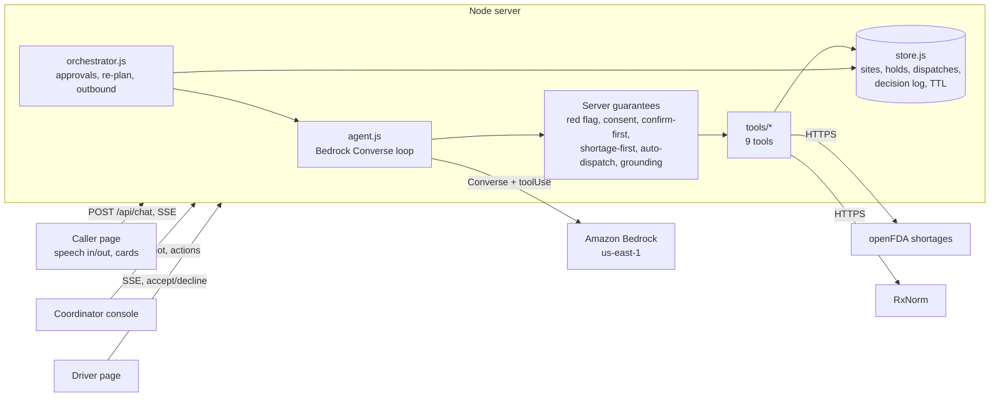
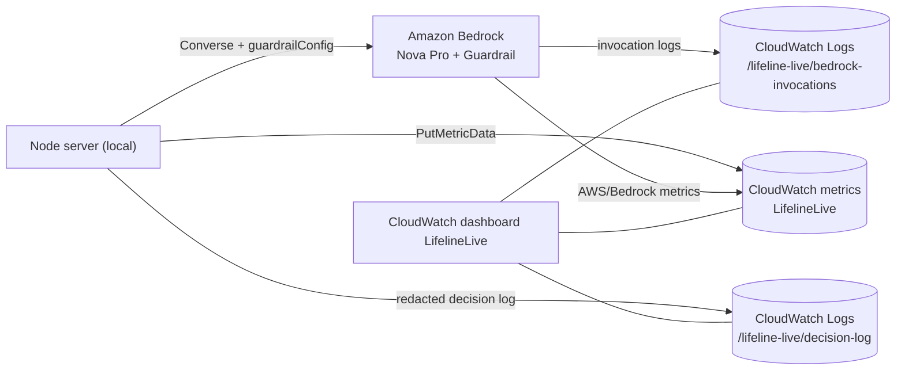

# Design Document

## Overview

Lifeline Live is a browser app plus a Node server. A caller speaks (Web Speech API) or types. The server runs an Amazon Bedrock tool-use loop (us-east-1). The agent can only act or state facts through nine tools. Tools read and write in-memory state that stands in for DynamoDB. Coordinator Rosa supervises on a console; volunteer drivers use a dispatch page.

## Components and the requirement each serves

| Component | Requirements |
|---|---|
| `public/js/caller.js`: mic, 1.5 s silence end-of-utterance, TTS, text fallback, 15 s timeout with retry, idempotent `clientMsgId` | 1, 14 |
| `classify_need`: six types plus `unclear`, max 2 clarifying questions then `info`, logged with reason | 2 |
| `find_resource`: open, stock ≥ 1, nearest first, max 5, info bulletins, 5 s timeout | 3, 12 |
| `check_shortage`: openFDA, 5 s timeout, 2 retries, 11 s overall deadline, 10 min cache, 404 = not listed | 4 |
| `reserve`: stock check plus site-version check (conditional write), unique `H-XXXX`, exactly once | 5 |
| `dispatch.js`, `dispatch_volunteer`: ETA in whole minutes, ordered route, batching | 6, 7 |
| `orchestrator.handleStockOut` and `finalizeReplan`: zero stock, void hold, re-route same driver, logged, 30 s target | 8 |
| `redflags.js` plus `agent.userTurn` fast path, `escalate` | 9 |
| `store.logDecision`: redacted, 3 write attempts, console shows oldest first | 10 |
| `approvals.js`, `orchestrator.decideApproval` | 11 |
| Grounding guard `ungroundedClaim` | 12 |
| `pii.js`, consent state machine, `sweep()` | 13 |
| `scripts/surge.mjs`, outbound call, `normalize_drug`, language selector | 15 |

## Data model (in memory; all records carry `expiresAt`)

- **site**: `id, kind, name, address, lat, lng, open, hasPower, refrigerated, hours, inventory{item:qty}, version`
- **hold**: `id (H-XXXX), sessionId, siteId, item, qty, status (active|void|fulfilled), expiresAt`
- **dispatch**: `id (D-XXXX), holdId, driverId, status (assigned|accepted|rerouting|delivered|failed), pickup, dropoff, route[], etaAt, distanceKm, batched, savedKm`
- **session**: location, language, consent state, optional address, need, transcript (redacted), active hold and dispatch
- **approval**, **alert**, **decision-log entry** (`ts, kind, level, summary, reason, data`)

## Re-plan sequence

1. Rosa presses Out of stock. Server sets stock to 0, bumps the site version, voids affected holds, marks the dispatch `rerouting`.
2. Server sends the agent a server event. The agent calls `find_resource`, `reserve` (covered by the earlier approval for the same item), `dispatch_volunteer` (re-routes the same driver).
3. `finalizeReplan` guarantees an end state whatever the model did: complete the re-route itself, or mark the dispatch failed, alert Rosa, and show the failure on the caller's card.

## Deliberate differences from the requirements text

These are choices made while building. Each is a decision for the team to confirm.

- **Req 5.1 / 6.1**: a driver is dispatched only when the caller cannot travel (inferred from their words, so it does not depend on the model). Callers who can travel are told where to go and the hours. The server dispatches automatically when delivery is needed and a hold exists.
- **Req 5.1**: reserve needs a caller turn after the site is offered. Coordinator-approved actions and re-plans are exempt.
- **Req 4.3**: the FDA listing is national, so it is reported to the caller and Rosa, but it cannot exclude individual sites (there is no per-site shortage data).
- **Req 6.4 / surge**: when no driver is free the hold stands, Rosa is alerted, and the caller is told a person will follow up. This is reported separately from errors in the surge test.
- **Req 8.3**: for a re-plan with no alternative the hold is already void (the site reported zero), the dispatch is marked failed, and the caller card shows the failure.
- **Req 13.3**: redaction is rule-based (Comprehend is unavailable): phones, emails, ids, street addresses, "my name is X" with a capitalised name, and known resident names. It misses lowercase spoken names and unusual formats.
- **Req 13.4 / 14**: ETAs and distances are straight-line estimates with a road factor; Amazon Location Service is unavailable.
- **Model**: Nova Pro by default because Claude on this account needs the Anthropic use-case form first.
- **Req 15.4**: Spanish and Vietnamese work for agent replies and 911 guidance; voice quality depends on the browser's installed voices.

## AWS integration

- **Guardrail** (`infra/guardrail.json`): output-side denied topic `medical-advice`, output-side harmful-content filters, input-side prompt-attack filter, PII detection on input and anonymisation on output. It is a second line of defence behind the code rules, not a replacement.
- **Scoped input.** The request wraps only the caller's own words in `guardContent`. Bedrock then evaluates only those blocks (verified with live calls). Without this, the prompt-attack filter blocked the server's own re-plan and correction messages.
- **Fail open, loudly.** If the Guardrail call itself fails (deleted, no permission), the app serves callers without it for an hour, raises a critical alert and logs it, because every rule that matters is also enforced in code.
- **Telemetry never affects a request.** `server/telemetry.js` batches logs (5 s) and metrics (30 s), swallows errors and logs each distinct failure once. The isolated surge-test store is never connected to it.
- **Invocation logging** stores full prompts and replies unredacted. See `safety.md` rule 11.
- **Latency cost.** The Guardrail adds about 200 ms of processing per model call in each direction (measured on a direct call).

## Error handling

Bedrock throttling retries with backoff (400 ms, 800 ms, 1.6 s). A failed agent turn gives the caller a fixed apology, raises a critical alert, and rolls back the model history so no dangling tool call remains. A failed `escalate` still delivers 911 guidance and alerts Rosa directly. External API failures return an explicit "unavailable" result; nothing is guessed.

## Testing

`npm run scenarios` (8 end-to-end scenarios on the real model plus a no-placeholder check), `npm run test:paths` (43 failure-path checks), `npm run surge` (tool layer 25 to 200 concurrent, plus optional live-agent run).
